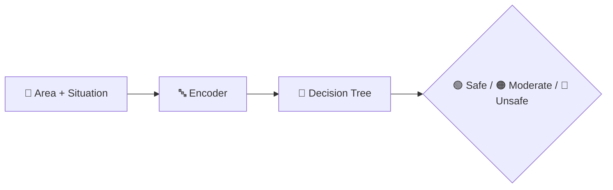

<div align="center">


<b><i>ML-driven safety insights for Chennai city</i></b>


      

   
</div>

---

## 👩‍🦰 About the Project

A machine-learning project that analyses **women-safety data for Chennai city** and predicts the **safety level** of an area / situation using a **Decision Tree** classifier. The goal is to turn data into actionable insights that help people make safer choices.

## ✨ Key Features

- 📊 Datasets: *Women Safety in Chennai City* & harassment survey data
- 🌳 Decision Tree model (`decision.pkl`) with encoder
- 📍 Area-wise **safety level prediction**
- 📚 Detailed docs: Quick Start, Setup Guide, Project Summary, Advanced README

## 🧠 How It Works



## 🛠️ Tech Stack

| Layer | Technology |
|---|---|
| Language | Python 3 |
| Data & ML | Pandas · NumPy · scikit-learn |
| Notebook | Jupyter |
| Web App | Flask + Jinja2 templates |
| Frontend | HTML5 · CSS3 |
| Data | Excel datasets (.xlsx / .xls) |

## 📂 Project Structure

```text
ML-WOMEN-SAFETY-master/
├── app.py
├── women safety.ipynb
├── Women Safety in Chennai City-Data.xlsx
├── decision.pkl · encoder.pkl
├── requirements.txt
├── static/ · templates/
└── README.md · QUICK_START.md · SETUP_GUIDE.md · PROJECT_SUMMARY.md
```

## 🚀 Getting Started

```bash
git clone https://github.com/PreciousBharath/WOMEN-SAFETY.git
cd WOMEN-SAFETY/ML-WOMEN-SAFETY-master
pip install -r requirements.txt
python app.py
```

## 🤝 Contributing

Contributions, issues and feature requests are welcome! Feel free to ⭐ star the repo and open a pull request.

## 👨‍💻 Author

<div align="center">

**Bharath** — Software Developer · Project Engineer · Technical Trainer

<a href="https://github.com/PreciousBharath"></a>
<a href="https://linkedin.com/in/connectbharath"></a>

### 🍔 EAT · 😴 SLEEP · 💻 CODE · 🔁 REPEAT

⭐ **If you found this project useful, give it a star!** ⭐


</div>
